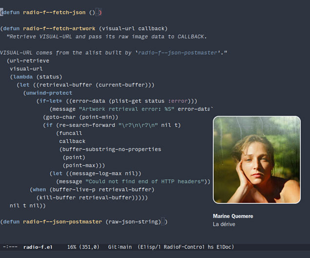
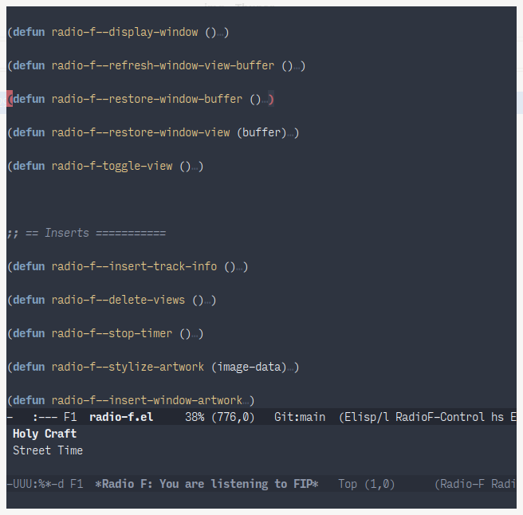
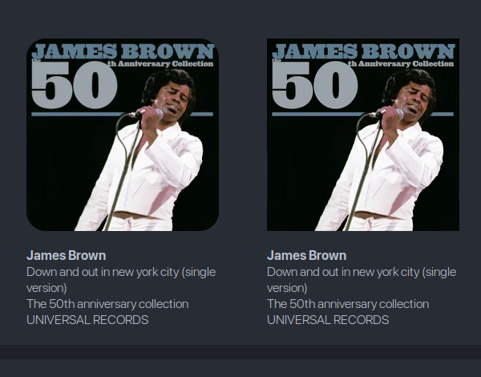

# Radio F

Radio F is a streaming library to access radio stations in Emacs.



## Features
* Supports 500+ stations and live streams from Radio France, BBC, CBC, RTÉ, Radio Deutschland, Radio Bremen, SWR, WDR, RTBF, ORF, and many more.
* Customizable information display, with artwork, track data, and selectable view style.
* Uses your choice of [mpv](https://mpv.io/), [VLC](https://www.videolan.org/), and [EMMS](https://www.gnu.org/software/emms/) as audio backends, with access to a selection of most commonly accessed controls: volume up/down, mute/unmute, pause, play, etc.

Radio F is licensed under the GNU General Public License, Version 3. See [LICENSE](https://github.com/cacepi/radio-f/blob/main/LICENSE) for details.

## Requirements
* A working version of either [mpv](https://mpv.io/), [VLC](https://www.videolan.org/) or [EMMS](https://www.gnu.org/software/emms/).
* A working version of [git](https://git-scm.com/) anywhere in your `$PATH` to download the source code.

## Installation

Installation is via a simple `use-package` definition placed in your `init.el` file:

<a id="use-package"></a>
```elisp
(use-package radio-f
  :vc (:url "https://github.com/cacepi/radio-f" :rev :newest)
  :commands (radio-f)
  :bind
  (("C-c f r" . radio-f)))
 ```

and evaluting the definition with `C-M-x`.  This will download the Radio F source code, compile it, and install Radio F just like Emacs does with any package installed via `package-install` This will also install natively compiled files if your Emacs instance supports native compilation.

After Radio F is installed, you can upgrade at any time by running `package-vc-upgrade` and selecting Radio F in the completion buffer.

<!--

<a id="straight"></a>
If you use [straight.el](https://github.com/radian-software/straight.el) for package management, you can try:

```
(use-package radio-f
  :straight (radio-f :type git :host github :repo "cacepi/radio-f"))
```
-->

## Commands
<a id="radio-f"></a> **`radio-f`**:
Starts playback of the station you've set in `radio-f-default-station`. A "Now Playing" buffer showing the currently playing song or program will open in a new window or child frame, depending on the value of [`radio-f-view-style`](#view-styles).

This function can be run non-interactively with an optional argument for a specific station. For example, `(radio-f "FIP Reggae")` will start Radio F tuned to FIP's Reggae station instead of your default.

Consult the [station list](https://raw.githubusercontent.com/cacepi/radio-f/refs/heads/main/STATIONS.md) for available stations.

This function is bound to `C-c f r` by default.

<a id="change-station"></a> **`radio-f-change-station`**: Select a different station in your favorites list to play.  Refer to [the favorites setting](#radio-f-favorite-stations) to see how to make your own favorites list.

This function is bound to `C-c f c` by default.

<a id="change-to-any-station"></a> **`radio-f-change-to-any-station`**: A variant of the above, except it bypasses your favorites and shows all stations supported by Radio F  Like `radio-f`, this function also accepts a station argument.

This function is bound to `C-c f a` by default.

<a id="play-default-station"></a> **`radio-f-play-default-station`**: Return to the [default station](#radio-f-default-station).

This function is bound to `C-c f a` and `F7` by default.

**`radio-f-surprise-me`**: Play a random station chosen from all carriers.

This function is bound to `C-c f ?` by default.

<a id="dark-mode"></a>**`radio-f-dark-mode`**: Start Radio F with no view.  See the [View Styles](#view-styles) section for more details.

This function is bound to `C-c f m` by default.

**`radio-f-down`**: Exit Radio F.

This function is bound to `C-c f o` by default.

## Helper Functions
<a id="resize-window-view"></a>**`radio-f-resize-window-view`**: Sometimes window view can get fail to properly size itself after changing the station.  This function resizes the view to the smallest it needs to be to display all the information that's inside the buffer.

This function is bound to `C-c f '` by default.

<a id="browse-station-page"></a>**`radio-f-browse-station-page`**: Opens your browser for the page of the currently playing station.

This function is bound to `C-c f w` by default.

**Note**: Radio France sets the page for local stations via a cookie, so you can't visit local stations directly.  Instead, this function will go to Radio France's local station portal, where you must pick the station page you want to see. Click the button labelled "Choisir une locale" for your choice.


<a id="view-styles"></a>
## View Styles:

Radio F has two different views for displaying track metadata: `'window`, and `'frame`:

* Frame view shows track metadata and accompanying artwork in a child frame attached to the calling parent. It will stay at the same position relative to its parent whenever the parent is resized.


* Window view shows the same information as frame view by default, except the display is in a normal window at the bottom the Emacs frame.  This view is intended for TUI Emacs users, and tries to provide the most compact view possible to preserve precious screen space.  In TUI Emacs sessions, artwork display and the track timeline are disabled.



* A third, pseudo "no view" mode can be enabled by starting Radio F with `radio-f-dark-mode`.  JSON fetch still occurs as normal, artwork is still downloaded and inserted into both views, but the view is not displayed until you call `radio-f-toggle-view` (bound to `C-c f v` by default).

* The view toggle is also available in both normal window and frame views.

A word of caution: the view toggle works by running `make-frame-visible` and `make-frame-invisible` on the frame view, which might cause display issues with the child frame if you toggle too quickly.  Give it a second or two after toggling before running again.


## Custom Variables

<a id="radio-f-default-station"></a> **`radio-f-default-station`**: The station which plays Radio F first starts.  Refer to the [station list](https://raw.githubusercontent.com/cacepi/radio-f/refs/heads/main/STATIONS.md) for all the stations supported under Radio F.

The default is `"FIP"`.

<a id="radio-f-player-program"></a>**`radio-f-player-program`**: Preferred player program. Accepted values are:

* `emms`- [Emacs Multimedia System](https://www.gnu.org/software/emms/)
* `vlc` - [VLC Media Player](https://www.videolan.org/vlc/)
* `mpv` - [mpv](https://mpv.io)\*

`vlc` and `mpv` must be in a directory contained in the Emacs `exec-path`.  If you've installed them through your operating system's package manager, you should have no problems.  If you've installed them into a non-standard directory location, you'll need to add it to the Emacs `exec-path`:

```elisp
  (add-to-list 'exec-path
               (expand-file-name "/directory/to/mpv/or/vlc") t nil)
```

\* _Graphical shells for mpv that utilize `libmpv` for playback (IINA, mpvnet, Baka Mplayer, Celluloid, etc.) are not supported._

The default is `vlc`.


<a id="radio-f-stream-level"></a>**`radio-f-stream-level`**: Choice of audio stream of varying quality/bitrate.  Higher stream levels offer successively lower audio quality or bitrate:

* `'One` Plays the highest quality/bitrate.
* `'Two` Plays a lower quality/bitrate than level One.
* `'Three` Even lower quality/bitrate.
* `'Four` Lowest quality/bitrate available.

Note that this does not mean that all carriers have four stream levels for each station, only that the most available for playback can be up to four.

_Station names that end with an asterisk `(*)` provide only a single audio stream. For these stations, `radio-f-change-stream-level` returns the same stream regardless of selected level._

The default is `'One`.

<a id="radio-f-view-style"></a>**`radio-f-view-style`**: Set the preferred view style. Can be either `'frame` or `'window`. Refer to the [View Styles section](#view-styles) for more details.

The default is `'frame`.

<a id="radio-f-favorite-stations"></a>**`radio-f-favorite-stations`**: List favorite stations for completion.  A nil value shows all stations.

Radio F currently supports 568 stations.  Scrolling through that list to change stations is... well, it's not fun. So, instead:

`customize-option [RETURN] radio-f-favorite-stations [RETURN]` presents you with a checkbox list to select only those stations that you want to see. The list will be set in the user's Custom file.

Or if you really hate to use Custom - and who doesn't? - you can copy the stations you want from the [station list](https://raw.githubusercontent.com/cacepi/radio-f/refs/heads/main/STATIONS.md) and place them in your `use-package` definition for Radio F.  For example:

```elisp
:config
(setq radio-f-favorite-stations
    "ici Bearn" "FIP" "FIP Rock" "FIP Jazz" "FIP Groove" "FIP Monde"
    "FIP Nouveautés" "FIP Reggae" "FIP Electro" "FIP Metal" "FIP Pop"
    "FIP Hip-Hop" "FIP Sacré Français!" "FIP Cultes" "RTÉ Radio 1"
    "BBC World Service" "BBC Shetland" "BBC Radio One" "Shonan Beach FM"
    "Deutschlandfunk Nova" "Bayern 3" "Bremen Vier Tanzt! Web")
```

will only show those 22 stations when you run [`radio-f-change-station`](#change-station) instead of all 568.  Remember, you can always choose from every station with [`radio-f-change-to-any-station`](#change-to-any-station).

<a id="radio-f-artwork-size"></a>**`radio-f-artwork-size`**: The size, in pixels, of the artwork image's height and width.

The default is `240`.

<a id="radio-f-show-artwork"></a>**`radio-f-show-artwork`**: Show artwork in either frame of window view: `t` shows artwork, `nil` disables it.

The default is `t`.

<a id="radio-f-show-track-info"></a>**`radio-f-show-track-info`**: Show track info in either frame of window view. A value of `t` shows track info, `nil` disables it.

The default is `t`.

<a id="radio-f-show-track-timeline"></a>**`radio-f-show-track-timeline`**: Display a timer showing the playing time of the current track. A value of `t` shows the timer, `nil` shows no timer.

The default is `nil`.

<a id="radio-f-artwork-border-width"></a>**`radio-f-frame-artwork-border-width`**: Width of the border, in pixels, that surrounds the artwork image. Set this to `0` if you don't want a border.

The default is `2`.

<a id="radio-f-artwork-radius"></a>**`radio-f-artwork-radius`**: Radius in pixels of the artwork's rounded corners in both frame and window view.  Set this to `0` if you don't want to round off the corners.

The default is `12`.

<a id="radio-f-default-volume"></a>**`radio-f-default-volume`**: Set the initial volume level for station playback.  The same level is used for both mpv and VLC.

This setting is not available in EMMS.

The default is `80`.

## Faces:

<a id="radio-f-default-face"></a>**`radio-f-default`**: Define the underlying base face applied to the text in the track info buffer.  This face is used in both frame and window view.

The default is `:inherit (variable-pitch)`.

<a id="radio-f-bold-face"></a>**`radio-f-bold`**: Face used for the artist of the playing track.  This face is used in both frame and window view.

The default is `:inherit (radio-f-default) :weight bold`.

<a id="radio-f-timer-face"></a>**`radio-f-timer`**: Face used for the track timeline.  This face is used in both frame and window view.

The default is `:inherit (default) :height 0.9 :weight bold`.

## Keybindings:

<a id="keybinds"></a> Keybinds are defined in the minor mode `radio-f-control-mode-keymap`:

```elisp
  "C-c f r"   #'radio-f
  "C-c f a"   #'radio-f-change-to-any-station
  "C-c f c"   #'radio-f-change-station
  "C-c f d"   #'radio-f-play-default-station
  "C-c f m"   #'radio-f-dark-mode
  "C-c f o"   #'radio-f-down
  "C-c f v"   #'radio-f-toggle-view
  "C-c f w"   #'radio-f-browse-station-page
  "C-c f ?"   #'radio-f-surprise-me
  "C-c f '"   #'radio-f-resize-window-view
  "<f7>"      #'radio-f-play-default-station
  "<f8>"      #'radio-f-pause-audio    ;; hit again to unpause
  "<f9>"      #'radio-f-change-station
  "<f10>"     #'radio-f-mute-audio     ;; hit again to unmute
  "<f11>"     #'radio-f-volume-down
  "<f12>"     #'radio-f-volume-up)
  ```

You can also change volume with the mouse wheel while the mouse cursor is inside a view;  wheel up to increase volume, wheel down to decrease.

## Tips:

* You can remove the minor mode lighters that Radio F installs in the modeline by including a `:delight` clause in your `use-package` definition like so:

```elisp
:ensure delight        ; installs the delight package: does nothing if already installed
:delight
(radio-f-control-mode) ; if using 'frame view
(buffer-face-mode)     ; if using 'window view
```

* Did I mention the favorites list? Only like 11 times already?  Let's make it an even dozen: go to the [station list](https://raw.githubusercontent.com/cacepi/radio-f/refs/heads/main/STATIONS.md) to learn how to build your list.  Your `n` and `p` keys - or arrow keys if you swing that way - will thank you.

* The VLC remote interface is over a network connection, and you can control it directly via telnet:

```
telnet localhost 1971
```

Have fun!

## Future Plans:

- Support for more station carriers. I intend to finish all the carriers that are members of the European Broadcasting Union.

- A record of the songs played during a listening session.

Most stations include a tracklist on their website, which you can visit with `radio-f-browse-station-page`, but if a station doesn't provide one, you're out of luck.  I think a more personalized version can made by constructing a track log and generate a PDF file or similar upon exiting Radio F.

## Not Future Plans:

- Support for NHK stations.  Unfortunately, NHK blocks all station access to anyone outside of Japan.

- More audio backends.  Playback has three player choices, one of which itself supports several, several, _several_ various playback engines.  Those three should cover 99%+ of people who would be interested in this project.

- Ability to add stations through Custom. This will potentially absolutely almost probably certainly never happen.

## Items to Note:

### SVG support encouraged, but not required.

Radio F uses the Emacs `svg` library to generate the rounded corners for the view artwork. The program will work without it; you just won't see those oh-so-sexy RoundRects in the artwork image:



### <a id="emms-is-big"></a>EMMS control is limited, because EMMS is *big*.

TL;DR - EMMS support is limited.  Because EMMS is **big**.

EMMS doesn't offer the same level of direct control that VLC and mpv provide through their remote interfaces.  EMMS can raise/lower volume, pause, and unpause, etc.  Other functions like mute, unmute, and setting the volume to arbitrary levels aren't supported.

Adding Radio F support for the functions that EMMS currently lack would require juggling control of six different audio mixers and 8-11 different players.  EMMS still has support mpg123/321 and Xine!  And, as EMMS includes a module for support of the [MPRIS](https://specifications.freedesktop.org/mpris/latest/) API, which brings a staggering **30+ players** to the mix, adding something simple as a mute function to EMMS that works with all players is miles above Radio F's pay grade. I just wanna chill to some cool music in Emacs.

As a result, if you choose EMMS as your default player, Radio F assumes that you have it configured to your preferences. Maybe more robust support could come one day, but not today.  Sorry, EMMS.

### The track timeline is inherently wrong.

Radio F uses metadata from a carrier to provide track information and the artwork for the currently playing song.  While this does work, most carriers, if not all, have a major problem entirely beyond Radio F's control; most metadata feeds do not, and cannot, indicate _when_ one track ends and another begins.

Most carrier feeds have fields which will show when a track _should_ start and end, but in the end it's still live radio, and any number of factors can throw those times off.  The feed can be pre-empted with a station ID, the DJ cuts a song early or belatedly inserts a song into the playlist, the stream is interrupted with "breaking news", and so forth.  And while computers are great at automating things, they have yet to master predicting the future.  Give it a few weeks.

If it's any consolation, Radio France's web player is affected the same way Radio F is, except their timeline is consistently "early" by showing a song is anywhere from 30 seconds to a whole minute into the track when that song begins.  BBC Radio One is consistently _late_ by at least 90 seconds with their track timings, and RTBF simply does not update track listings for several hours at times.  Then there are the carriers that have absolutely no track timing information whatsoever, which makes a track timeline completely useless. _Wunderbar._

As a result, Radio F can vary wildy with track transition timings.  It's only when the timer misses that it becomes a very visible issue.  And we can't trust the carrier to be accurate, either, as ofttimes they themselves don't know when the track transitions occur.  That's why the default timeline setting is `nil`; its inherent inaccuracy is visually confusing.

### <a id="beeb-stations-missing"></a>The Beeb's Missing Stations

The following BBC foreign language and World Service stations only have a few hours of airtime a day, so they are unsupported:

<pre>
"BBC Afrique Radio"
"BBC Amharic Radio"
"BBC Arabic Radio"
"BBC Burmese Radio"
"BBC Dari Radio"
"BBC Gahuza Radio"
"BBC Hausa Radio"
"BBC Korean Radio"
"BBC Nepali Radio"
"BBC Oromo Radio"
"BBC Pashto Radio"
"BBC Somali Radio"
"BBC Swahili Radio"
"BBC Tigrinya Radio"
"BBC Uzbek Radio"
"BBC World Service Americas"
"BBC World Service Australasia"
"BBC World Service East Africa"
"BBC World Service East Asia"
"BBC World Service Europe"
"BBC World Service News Internet"
"BBC World Service South Asia"
"BBC World Service UK"
"BBC World Service West Africa"
</pre>

### Radio F est en direct.

Radio F plays back live radio, and JSON feeds can go sideways from time to time, mainly due to station breaks or interruptions of regularly scheduled programming with live coverage. For example, Radio France handles such interruptions by issuing JSON that contains a single key value, "Le direct" ("live coverage" in French), and has no other useful information.

<!-- La radio la plus éclectique du monde -->

This means a user can start Radio F when a JSON feed is in a "Le direct" state, and no track info will appear on startup.  This is intentional: if there's nothing to show... well, you know the rest.

_C'est la vie, mon ami._

